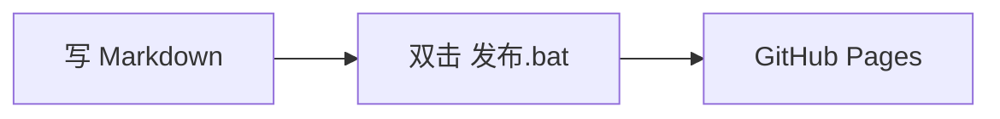

这篇写给以后的我：这套站怎么加文章、图片放哪、怎么上线。

## 加一篇文章

在 `source/_posts/` 下新建一个 `.md`，文件名用英文短横线（它决定网址），标题写在 front-matter 里：

```yaml
---
title: 文章标题
date: 2026-10-20 21:30:00
categories:
  - 随笔        # 随笔 / 笔记 二选一
---
```

- 分类写「随笔」，文章会进 `随笔` 板块，每页 8 篇自动分页
- 分类写「笔记」，文章会进 `笔记` 板块
- 两个都会出现在首页最新文章里

## 图片放哪

**一篇文章一个同名目录。** 比如文章是 `my-post.md`，就在旁边建 `my-post/`，图丢进去：

```
source/_posts/
├── my-post.md
└── my-post/
    ├── 截图.png
    └── 流程图.jpg
```

正文里用最普通的 Markdown 图片语法就行，路径写图名：

```markdown

```

不用写 `../../images/` 这种相对路径，Hexo 会把图按文章网址归位。

## 图片会自动压成 WebP

构建时 `scripts/webp.js` 会：

1. 把文章目录里的 png/jpg 转成同名 `.webp`（长边 1600px，质量 80）
2. 把正文里的 `.png` / `.jpg` 引用改成 `.webp`
3. 生成完后，`public/` 里只保留 WebP，原图不随站点发布

所以**只需要往目录里丢 png/jpg**，不用手动转格式，也不用上传 WebP。

## 发布

**双击仓库根目录的 `发布.bat`**：它会让我填一句提交说明，然后提交、推送，GitHub Actions
自动构建并发布到 GitHub Pages，地址是 <https://202367jack.github.io/hexo-aether-blog/>。

不想用 bat 的话也还是老三行：

```powershell
git add .
git commit -m "写点什么"
git push
```

## 加影视 / 加项目

- 影视：在 `source/media/` 下建一个目录（如 `source/media/interstellar/`），里面放 `index.md` 和海报 `poster.jpg`，front-matter 里写 `type: media`、`rating`、`medium`、`genre`、`region`、`year`、`quote`
- 项目：在 `source/projects/` 下建目录放 `index.md`，front-matter 里写 `type: project`、`summary`、`stack`、`repo`

列表页会自动多出一张卡，不用改任何模板。

## 系列文章

front-matter 里加一行 `series`，同一个名字的文章会归到一个系列，文章右侧会出现「系列」卡片，
点进去就是按顺序排好的全部文章：

```yaml
series: 建站记        # 同一个系列用同一个名字
```

两篇及以上才有意义，单篇只会显示它自己。

## 画流程图

正文里直接写 ` ```mermaid ` 代码块，构建时会渲染成图（浅色/深色两套主题自动切换）：

````markdown

````

时序图也一样，把第一行换成 `sequenceDiagram` 就行。

## 代码块

代码块默认就会折叠到 600px 高，右上角有「展开全文 / 复制 / 全屏」，行号也在。不用写任何标记。
