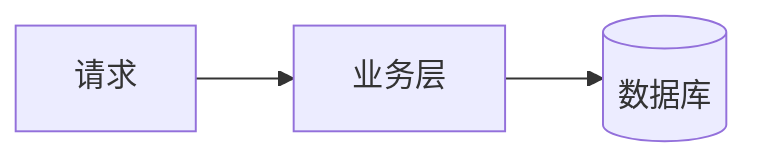

## 背景

要解决什么问题、为什么记这一篇。

## 正文

```java
// 代码块直接写，主题自带高亮、行号和复制按钮
public class Demo {
    public static void main(String[] args) {
        System.out.println("hello");
    }
}
```

## 画个图

````markdown

````

## 小结

一句话总结，或者留下没解决的问题。

<!--
用法：复制到 source\_posts\ 下，重命名成 今天日期-英文短名.md，
     再建同名文件夹放图片，改上面的 title / date / tags。
     笔记板块不分页，全部列在一页上。
     series：同一系列的多篇填同一个名字（如 建站记），会生成系列导航；单篇留空。
-->
